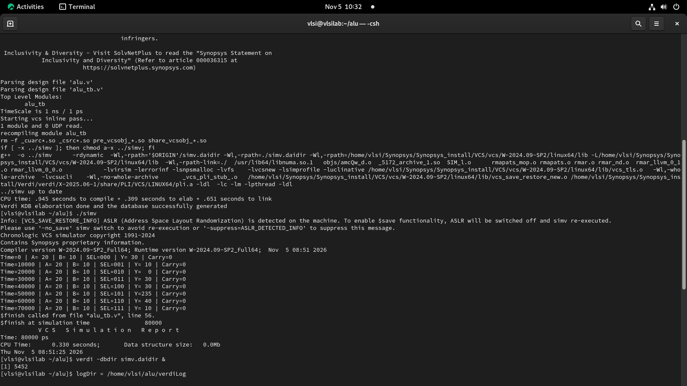
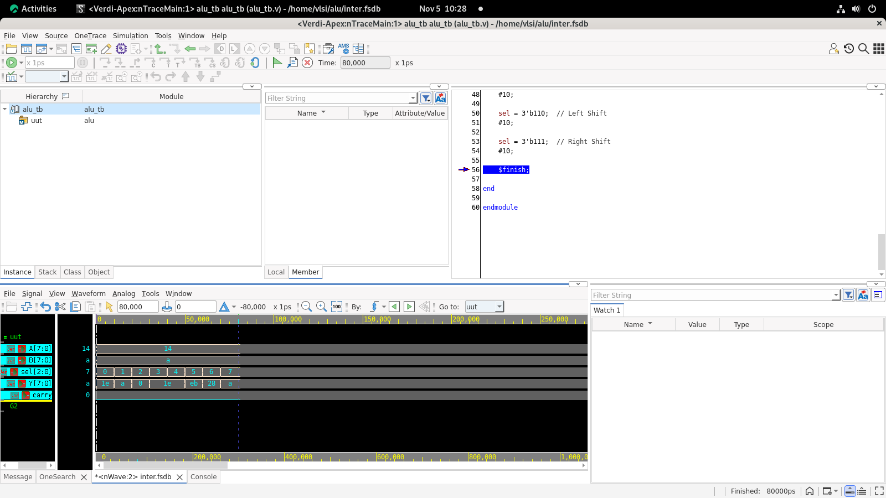

# 8-Bit ALU Design Using Verilog HDL

## Project Overview

This project implements an 8-bit Arithmetic Logic Unit (ALU) using Verilog Hardware Description Language (HDL).

The ALU performs eight different arithmetic and logical operations based on a 3-bit select input. The design is verified using a Verilog testbench and simulated using Synopsys VCS. The generated simulation waveform is analyzed using Synopsys Verdi.

## Features

- 8-bit input operands (A and B)
- 8-bit output (Y)
- 3-bit operation select input
- Carry output for addition
- Combinational logic design
- Testbench-based verification
- Simulation waveform generation
- Waveform analysis using Synopsys Verdi

## Supported ALU Operations

| Select | Operation | Description |
|:---:|---|---|
| 000 | Addition | A + B |
| 001 | Subtraction | A - B |
| 010 | AND | A & B |
| 011 | OR | A \| B |
| 100 | XOR | A ^ B |
| 101 | NOT | ~A |
| 110 | Left Shift | A << 1 |
| 111 | Right Shift | A >> 1 |

## Project Structure

```text
ALU-Design/
│
├── alu.v
├── alu_tb.v
├── README.md
│
└── images/
    ├── terminal_output.png
    └── verdi_waveform.png
```

## Tools and Technologies

- Verilog HDL
- Synopsys VCS (Simulation)
- Synopsys Verdi (Waveform Analysis)
- Rocky Linux

## Simulation Procedure

### Step 1: Navigate to Project Directory

```bash
cd ~/alu
```

### Step 2: Compile Verilog Files Using VCS

```bash
vcs -full64 -sverilog -debug_access+all alu.v alu_tb.v -o simv
```

### Step 3: Run Simulation

```bash
./simv
```

### Step 4: Open Waveform Using Verdi

If the testbench generates an FSDB waveform file:

```bash
verdi -ssf inter.fsdb
```

## Testbench Details

The testbench applies the following input values:

- A = 20
- B = 10

All eight ALU operations are tested by changing the 3-bit select signal at regular time intervals.

The testbench uses:

- `timescale` for simulation time precision
- `$monitor` to display simulation results
- `$dumpfile` and `$dumpvars` for VCD waveform generation, if enabled

## Expected Simulation Results

| Operation | Expected Output (Decimal) |
|---|---:|
| Addition | 30 |
| Subtraction | 10 |
| AND | 0 |
| OR | 30 |
| XOR | 30 |
| NOT A | 235 |
| Left Shift | 40 |
| Right Shift | 10 |

## Simulation Results

### 1. Terminal Output

The terminal screenshot shows the Synopsys VCS compilation and simulation execution.



### 2. Verdi Waveform

The Verdi waveform displays the ALU input signals, select signals, output values, and carry signal during simulation.



## Concepts Covered

- Combinational Logic Design
- Arithmetic Operations
- Logical Operations
- Verilog HDL Coding
- Testbench Development
- Functional Simulation
- Waveform Analysis
- Digital Design Verification

## Conclusion

The 8-bit Arithmetic Logic Unit was successfully designed using Verilog HDL. The design supports eight arithmetic and logical operations and was verified using a dedicated testbench. Synopsys VCS was used for simulation, and Synopsys Verdi was used to analyze the generated waveforms.

This project provides practical experience in digital design, Verilog programming, functional verification, and Synopsys EDA tools.

---

**Project Name:** 8-Bit Arithmetic Logic Unit (ALU)

**HDL:** Verilog

**Simulation Tool:** Synopsys VCS

**Waveform Tool:** Synopsys Verdi
